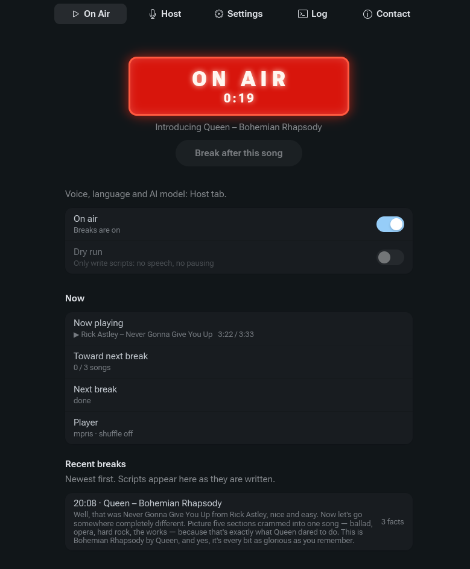
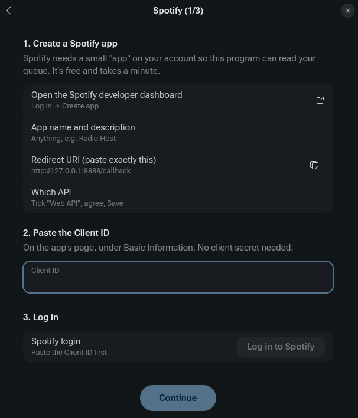
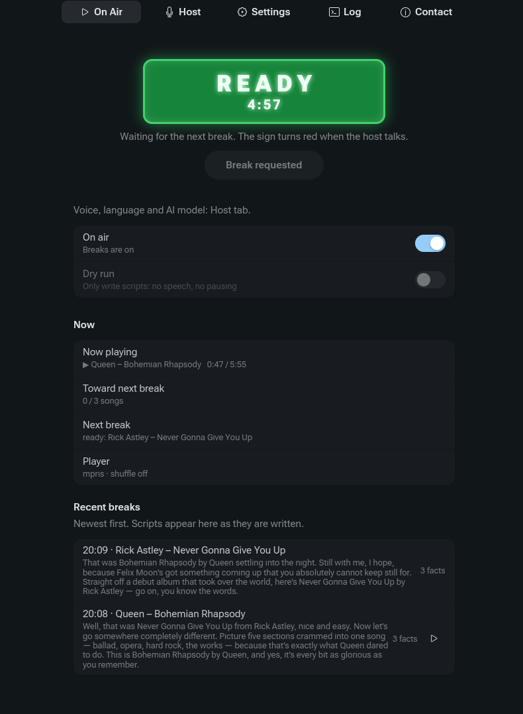
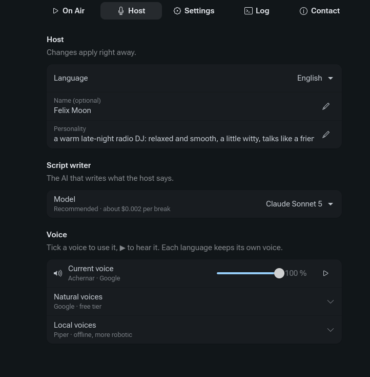
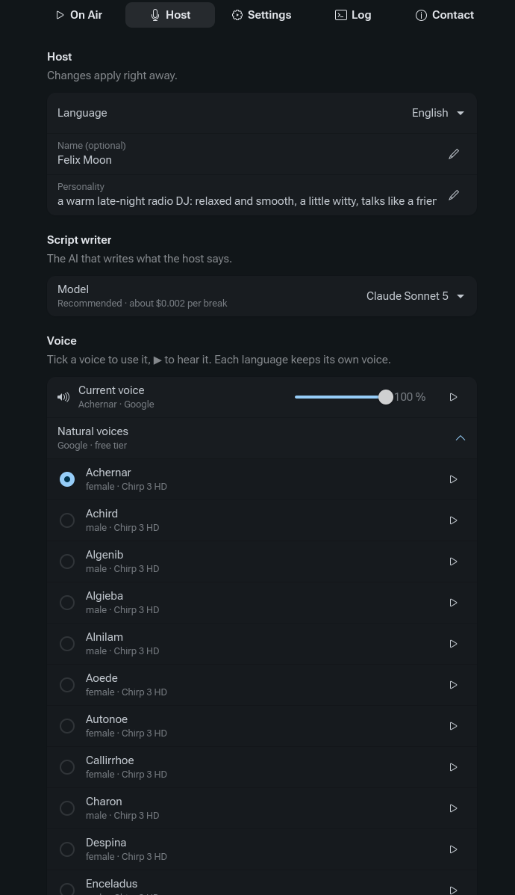
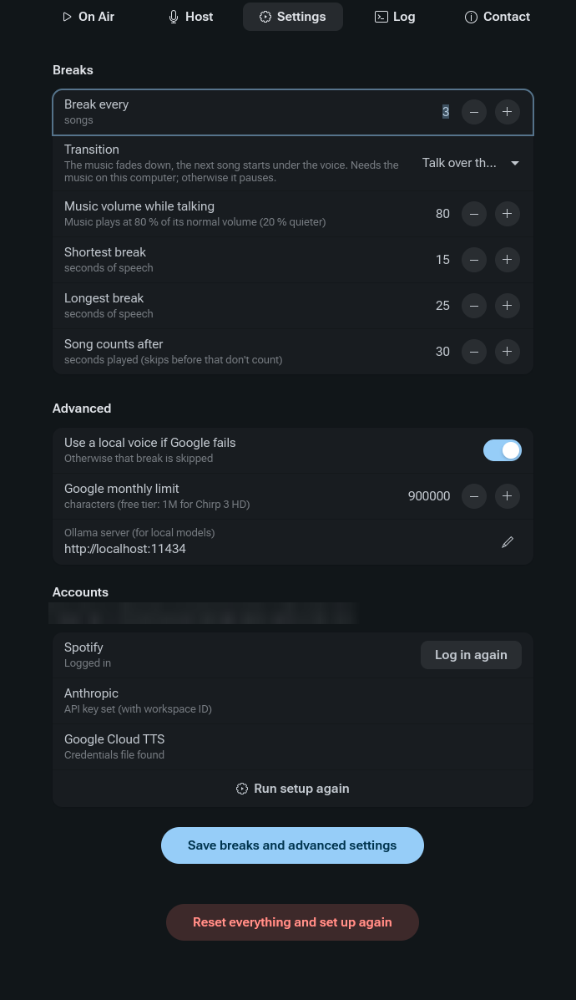
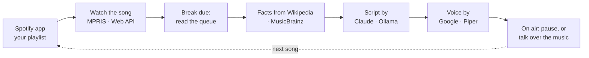

<p align="center">
  
</p>

<h1 align="center">AI Radio Host</h1>

<h3 align="center"><i>You pick the music. It does the talking.</i></h3>

<p align="center">A personal AI radio host for your own Spotify playlist, on the Linux desktop</p>

<p align="center">
  <a href="https://github.com/matyas-zavora/ai-radio-host/actions/workflows/tests.yml"></a>
  <a href="https://github.com/matyas-zavora/ai-radio-host/releases/latest"></a>
  <a href="LICENSE"></a>
  
  
  
  <a href="#how-this-was-made"></a>
  <a href="https://github.com/matyas-zavora/ai-radio-host/discussions"></a>
</p>

You play music in Spotify as usual. Every few songs (default 3), an AI host
introduces the next song in 15–25 seconds of speech, the way a radio DJ does,
with real facts about the song and the artist. Then the music carries on.

<p align="center">
  
</p>

- **Real facts only.** Facts come from Wikipedia (in your host's language, then
  English) and MusicBrainz. The AI may only use those. When nothing is found,
  the host does a simple intro with no trivia.
- **No gap.** Each break is prepared while the current song is still playing.
- **English or Czech**, with a host name and personality you choose.
- **Claude or a local model.** Scripts come from Claude (about $0.002 per break)
  or, for free, from a local model through [Ollama](https://ollama.com).
- **Natural or offline voices.** Google Cloud TTS (natural, free tier) or Piper
  (free, offline).
- **A real app.** GTK4 window with a studio ON AIR sign, a tray icon, a voice
  picker with samples, and a setup wizard that does the configuration for you.
- **Two transitions.** By default the music **pauses** while the host talks.
  Optionally the host can **talk over the music**: it fades down at the end of
  the song, the next song starts quietly under the voice, and the music fades
  back up (see [Talking over the music](#talking-over-the-music)).

> **Vibecoded.** This app was built through conversation with an AI: I designed it,
> made the decisions and tried it out, and Claude wrote the code and the tests. See
> [How this was made](#how-this-was-made).

## Requirements

- Linux with PipeWire or PulseAudio
- **Spotify Premium** (Spotify only opens its developer API to Premium accounts)
- The Spotify desktop app, or another Spotify player such as
  [Spotifast](https://github.com/crmne/spotifast), spotifyd, ncspot or Spot
- Python 3.11+ with GTK 4.10+ and **libadwaita 1.6+** (Arch, Fedora 41+, Ubuntu 24.10+, Debian 13+):
  - Arch: `sudo pacman -S python-gobject gtk4 libadwaita`
  - Fedora: `sudo dnf install python3-gobject gtk4 libadwaita`
  - Debian/Ubuntu: `sudo apt install python3-gi gir1.2-gtk-4.0 gir1.2-adw-1 python3-venv`
- For the AI, one of:
  - an [Anthropic](https://platform.claude.com) API account with a few dollars of credit (best results), or
  - [Ollama](https://ollama.com) with a local model (free, weaker results)

## Install

```bash
git clone https://github.com/matyas-zavora/ai-radio-host.git
cd ai-radio-host
./install.sh
```

Or download a tarball from [Releases](https://github.com/matyas-zavora/ai-radio-host/releases),
unpack it and run `./install.sh`.

Everything stays in your home folder, and no sudo is needed:

- the app goes into `~/.local/share/ai-radio-host`
- the `radiohost` and `radiohost-gui` commands go into `~/.local/bin`
- **AI Radio Host** appears in your app launcher
- your settings live in `~/.config/ai-radio-host/`

**Update:** `git pull && ./install.sh`. Your settings are kept.
**Uninstall:** `./install.sh --uninstall`. Your settings in `~/.config/ai-radio-host/` are kept.

## First start

Open **AI Radio Host**. A setup wizard walks you through three steps and saves
everything for you:

1. **Spotify.** Spotify requires every user to register their own small,
   free "developer app" (a minute in the browser). The wizard opens the right
   page, gives you the redirect URI to copy, takes the Client ID and logs you in.
2. **AI.** Paste an Anthropic API key and check it with one click, or switch
   on "Use a local model (Ollama)".
3. **Voice and language.** Piper works right away. For Google's natural voices,
   pick your Google Cloud key file (see [Google Cloud TTS](#google-cloud-tts)).

<p align="center">
  
</p>

Then start your playlist in Spotify and switch **On air** on.

You can run the wizard again from **Settings → Accounts**, or wipe everything
with **Reset everything and set up again** at the bottom of Settings.

## FAQ

<details>
<summary><b>Doesn't Spotify already have this? (Spotify's DJ)</b></summary>

Spotify's DJ is great for discovering music, but **it picks the songs itself**:
it plays its own selection based on your taste, which you can steer with
requests, but you can't point it at one of your playlists. AI Radio Host does
the opposite. **You choose the music**, whether it's your playlist, an album or
your queue, in your order or shuffled, and the host only adds the talk between
those songs. You also choose the host's name, personality, voice and how often
it speaks.

</details>

<details>
<summary><b>Does it work without Spotify Premium?</b></summary>

No. Spotify only lets Premium accounts use its developer API, which the app
needs to see your queue (what plays next) and to pause and resume playback.

</details>

<details>
<summary><b>Why do I need my own Spotify "developer app"?</b></summary>

Spotify limits each developer app to a handful of users unless it's run by an
established business, so one shared app for everyone isn't possible. Creating
your own is free and takes a minute, and the [setup wizard](#first-start)
walks you through it.

</details>

<details>
<summary><b>How much does it cost?</b></summary>

- **Script writer:** Claude costs about $0.002 per break, roughly a cent per
  hour of listening with the default settings. A local model through Ollama is free.
- **Voice:** Piper is free. Google's natural voices are free up to 1 million
  characters a month (one break is about 350), and the app switches to Piper
  before you reach that ([details](#google-cloud-tts)).

The app itself is free and open source.

</details>

<details>
<summary><b>Does it work on Windows or macOS?</b></summary>

Not yet. It's built on Linux desktop technology (GTK4, MPRIS, PulseAudio or
PipeWire). If you'd like another platform, say so in
[Ideas](https://github.com/matyas-zavora/ai-radio-host/discussions/categories/ideas).

</details>

<details>
<summary><b>Does it work when the music plays on my phone or a speaker?</b></summary>

The default **pause** mode should, because the app can control any Spotify
device through Spotify's API, but this hasn't been tested much yet. The host's
voice still comes from your computer. **Talking over the music** needs the
music on the same computer; otherwise that break pauses instead.

</details>

<details>
<summary><b>Is this allowed by Spotify's rules?</b></summary>

The default setup is built to respect them: the music pauses while the host
talks (nothing overlaps), and no Spotify data is sent to the AI
([privacy](#privacy-what-goes-where)). The optional **talk over the music**
mode goes against Spotify's Developer Policy, which forbids overlapping Spotify
audio with other audio, so it's off by default and your choice to turn on
([details](#talking-over-the-music)). This isn't legal advice.

</details>

<details>
<summary><b>Doesn't the AI make things up?</b></summary>

The AI is told to use only the facts the app found on Wikipedia and
MusicBrainz, and to do a simple introduction when there are none. Claude
follows that well; small local models slip more often. It's not perfect, so
treat the host as a friendly DJ, not an encyclopedia.

</details>

<details>
<summary><b>Why was a break skipped?</b></summary>

Usually because the queue changed just before the end of the song, the next
item was a podcast or the queue was empty, the song was too short to prepare
in time, or the AI or voice service failed. The music always carries on, and
the **Log** tab says exactly why.

</details>

<details>
<summary><b>Can I use my own voice, or a famous presenter's?</b></summary>

The app uses stock synthetic voices from Google and Piper; nobody's voice is
copied. Imitating a real person without their consent isn't supported and
shouldn't be done. Your own voice is technically possible with a custom-trained
Piper voice model (advanced, not covered here).

</details>

<details>
<summary><b>Which languages does the host speak?</b></summary>

English and Czech for now. Want another one? Suggest it in
[Ideas](https://github.com/matyas-zavora/ai-radio-host/discussions/categories/ideas).

</details>

<details>
<summary><b>The installer says libadwaita is too old.</b></summary>

The app needs libadwaita 1.6 or newer. Ubuntu 24.04 ships 1.5, so you'd need
Ubuntu 24.10 or newer, Debian 13, Fedora 41+, Arch, or a similar recent
distribution.

</details>

<details>
<summary><b>The Spotify login fails or never finishes.</b></summary>

Almost always the **redirect URI** in your Spotify developer app. It must be
exactly `http://127.0.0.1:8888/callback` (not `localhost`), with **Web API**
ticked, and you must log in with your Premium account. The login gives up
after 3 minutes and says what to check. Still stuck?
[Ask for help](https://github.com/matyas-zavora/ai-radio-host/issues/new?template=question.yml).

</details>

## The app

| Tab | What it's for |
|---|---|
| **On Air** | The studio sign: grey **OFF**; green **READY** while waiting, with how many songs are left or a countdown to the break; red pulsing **ON AIR** while the host talks, with the time left. Also the on-air and dry-run switches, **Break after this song**, the current song, and the recent scripts (▶ replays one). |
| **Host** | Everything about the host, applied immediately: language, name, personality; the **script writer** (Claude Sonnet 5, Haiku 4.5, Opus 5, or a local Ollama model); the **voice** (volume with a ▶ test, and all Google and Piper voices for the language with ▶ samples). Each language keeps its own voice. |
| **Settings** | Breaks (how often, the transition, music volume while talking, length, when a skipped song still counts), advanced options, accounts, **Run setup again**, and **Reset everything**. |
| **Log** | What the app is doing, including the full text of every break and why a break was skipped. |
| **Contact** | Version, links to the project page, bug reports, ideas (in Discussions) and updates, **Copy system info** for bug reports, and credits. |

<p align="center">
  
  
</p>
<p align="center">
  
  
</p>

A tray icon shows the state (grey off, white on air, red talking). Left-click
opens the window; right-click has On air, Break after this song and Quit. If
you close the window while on air, the app asks whether to keep running in the
background.

## Talking over the music

**Settings → Breaks → Transition → Talk over the music** turns on the radio-style
transition: the Spotify app's volume fades down (default to 30 %), the host
starts talking over the end of the song, the next song begins quietly under the
voice about halfway through, and the music fades back up afterwards.

- It only works when the music plays **on this computer**, because it lowers
  the player's own audio stream (PulseAudio/PipeWire). With a phone or speaker,
  or a very short song, that break pauses instead.
- If you pause, skip or change the volume yourself during a break, the app
  steps back immediately. If it crashes while the music is lowered, the volume
  is restored on the next start.
- **Spotify's rules:** the [Spotify Developer Policy](https://developer.spotify.com/policy)
  (III.7) says apps must not "overlap any Spotify Content with any other audio
  content". That's why this mode is off by default. Turning it on is your
  choice. The default **Pause the music** mode doesn't overlap anything.

## Privacy: what goes where

| Service | What it receives |
|---|---|
| **Spotify** (your own developer app) | Read access to what's playing and your queue; pause/play only in fallback cases. |
| **Wikipedia, MusicBrainz** | Searches for the song title and artist. |
| **Anthropic** (or your local Ollama) | Only the Wikipedia/MusicBrainz facts and the host's instructions. **No Spotify data**: the AI writes `{song}`/`{artist}` placeholders that the app fills in locally, because Spotify's terms forbid feeding Spotify content (including song metadata) into AI models. |
| **Google Cloud TTS** (if used) | The text of the break, to turn it into speech. |

Keys are stored in `~/.config/ai-radio-host/.env` (readable only by you). The
app has no server of its own and collects nothing.

## Google Cloud TTS

Google's Chirp 3 HD voices sound far more natural than Piper. The free tier
covers 1 million characters a month, and one break is about 350 characters.

1. At <https://console.cloud.google.com>, create a project.
2. Link a billing account. Google requires one even for the free tier.
3. **APIs & Services → Library** → enable **Cloud Text-to-Speech API**.
4. **IAM & Admin → Service Accounts** → create one (no roles needed) →
   **Keys → Add key → JSON**.
5. In the app's setup wizard (voice step), choose that JSON file. The wizard
   copies it to `~/.config/ai-radio-host/` with private permissions.

The app counts its own characters and stops using Google at 900,000 a month
(Settings → Advanced), switching to Piper. For a hard limit on spending, see
[`tools/gcp-billing-cap`](tools/gcp-billing-cap/setup.sh): a budget that
triggers a small Cloud Function to unlink billing from the project at the
first real charge.

```bash
tools/gcp-billing-cap/setup.sh PROJECT_ID 0 1   # cut billing above 0; budget of 1 (account currency) for email alerts
```

## Local AI with Ollama

Install [Ollama](https://ollama.com), run `ollama pull qwen2.5:7b` (or any
model you like), then pick it under **Host → Script writer** or in the setup
wizard. No account or key is needed. Small local models stick to the
facts-only rule less reliably than Claude and are weak in Czech, so expect
plainer breaks with the occasional made-up detail.

## How it works



- The current song and its position come from the Spotify app over MPRIS, the
  standard Linux media-player interface: local, fast, no rate limits. If MPRIS
  doesn't answer or doesn't report the position, the Spotify Web API is used.
- The queue only exists in the Spotify Web API. It is read when a break is
  due, again about 30 s before the end (so a changed queue can be regenerated),
  and a final time just before the host starts. If the song that's about to
  play doesn't match the prepared break, the break is skipped.

| Situation | What happens |
|---|---|
| You skip a song | It counts toward the break only if it played at least 30 s. A break prepared for the wrong song is dropped. |
| You change the queue | The recheck catches it and the break is regenerated; if it's too late, the break is skipped. |
| You pause | Nothing happens. The app never presses play on its own, except to resume after its own break. |
| You press play or skip during a break | The host stops and you keep control. |
| Shuffle | Works: Spotify reports the shuffled order (`radiohost queue-test` checks it). |
| Queue empty, or a podcast is next | The break is skipped, and the next song gets it instead. |
| Spotify closed or restarted | The app waits and picks up again. |
| Rate limits, expired login | It backs off and refreshes the login automatically. |
| Facts, AI or voice fail | That break is skipped and the music keeps going. If Google fails, Piper takes over. |

## Command line

```bash
radiohost run                   # the host without the window
radiohost run --dry-run --every 1   # only print a script for every song: no voice, no pausing
radiohost once                  # speak one break for the next queued song now (playback untouched)
radiohost once --lang cs        # the same in Czech
radiohost queue-test            # check that Spotify's queue predicts the next song (read-only)
radiohost auth                  # Spotify login without the wizard
radiohost gui                   # open the window (same as radiohost-gui)
```

Add `-v` for debug logging, which shows the facts used.

## Configuration

Everything in the app is stored in `~/.config/ai-radio-host/config.toml`, and
keys in `~/.config/ai-radio-host/.env`. See [`config.example.toml`](config.example.toml)
and [`.env.example`](.env.example) for every option, if you prefer editing files.

## Known limitations

- Linux only (GTK4, MPRIS, PulseAudio/PipeWire).
- Spotify's developer "development mode" allows up to 5 users per developer
  app, which is why every user registers their own (the wizard guides you).
- The official Spotify desktop app hasn't been tested much yet. Spotifast is
  the most tested player.
- If you change the queue in the last few seconds before a break, the host can
  introduce the wrong song.
- How the "talk over the music" fades sound with real music hasn't been tuned
  by ear much yet.

## Development

```bash
git clone https://github.com/matyas-zavora/ai-radio-host.git && cd ai-radio-host
uv venv --system-site-packages -p /usr/bin/python3 .venv    # system Python, for GTK
uv pip install --python .venv/bin/python -e '.[piper,google]' pytest
.venv/bin/python -m pytest
.venv/bin/radiohost-gui
```

A source checkout reads `config.toml` and `.env` from the project folder
instead of `~/.config/ai-radio-host/`.

| Module | Role |
|---|---|
| `radiohost/player.py` | Player control: MPRIS (any Spotify app), Spotifast CLI, Spotify Web API, with fallback |
| `radiohost/spotify_api.py` | PKCE login, token refresh, rate-limit back-off, queue |
| `radiohost/loop.py` | Counting songs, planning breaks, queue checks, pause or talk-over |
| `radiohost/facts.py` | Wikipedia and MusicBrainz lookups |
| `radiohost/script.py` | The host prompt (Claude or Ollama), placeholders, validation |
| `radiohost/tts.py`, `voices.py` | Google and Piper voices, monthly budget, samples |
| `radiohost/ducking.py` | Lowering and restoring the player's volume |
| `radiohost/audio.py` | Playing the clip |
| `radiohost/gui.py`, `setup_wizard.py`, `tray.py` | The app, the wizard, the tray icon |
| `radiohost/config.py` | Settings and keys |

## How this was made

AI Radio Host is a **vibecoded** project. I described what I wanted, made the
design decisions and tried things out on my own setup, and
[Claude](https://claude.com/claude-code) (Anthropic's AI, in Claude Code) wrote
the code, the tests and most of this README, step by step in one long
conversation. Every commit made this way says so (`Co-Authored-By: Claude`).

### Why AI?

- **The code:** building it with AI was much easier and faster for me than
  writing it myself. The trade-off is that I don't know the code in detail. For
  me the app is partly a black box: I know what it does and how it behaves, but
  not every line. That's one more reason why bug reports matter, and why the
  tests run automatically on every change.
- **The break scripts:** what the host says changes every time. It depends on
  the song, the facts found and the previous song. That can't be prepared in
  advance or programmed as fixed rules, so an AI writes it, using only the facts
  it was given.
- **The voice:** because every break is different, pre-recording them isn't
  possible, whether with my voice or a paid voice actor. Speech synthesis
  (Google or the local Piper) reads the script aloud. No real person's voice is
  imitated: these are stock synthetic voices, not voice clones.

### What that means for you


- **It's tested, but not everything.** Automated tests run on every change
  (Python 3.11–3.14), and the main features were tried on a real setup (Arch
  Linux, Spotifast). What hasn't been tried by a person yet is listed under
  [Known limitations](#known-limitations).
- **Bugs are likely.** Reports are very welcome and help a lot.
- **The code is all here.** Read it, check it, improve it.

## Feedback

- **Found a bug?** [Report it](https://github.com/matyas-zavora/ai-radio-host/issues/new?template=bug_report.yml)
  and paste the output of **Contact → Copy system info** from the app.
- **Have an idea?** [Share it in Discussions](https://github.com/matyas-zavora/ai-radio-host/discussions/categories/ideas),
  where others can upvote and discuss it.
- **Stuck with setup?** [Ask for help](https://github.com/matyas-zavora/ai-radio-host/issues/new?template=question.yml).

## License

[MIT](LICENSE). Not affiliated with Spotify, Anthropic or Google.
